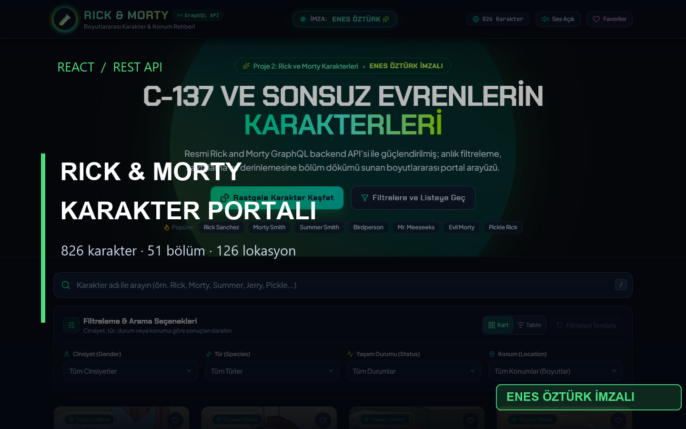
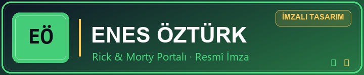
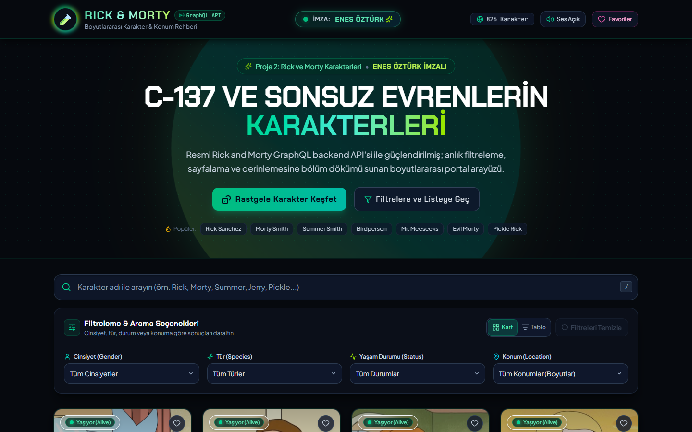
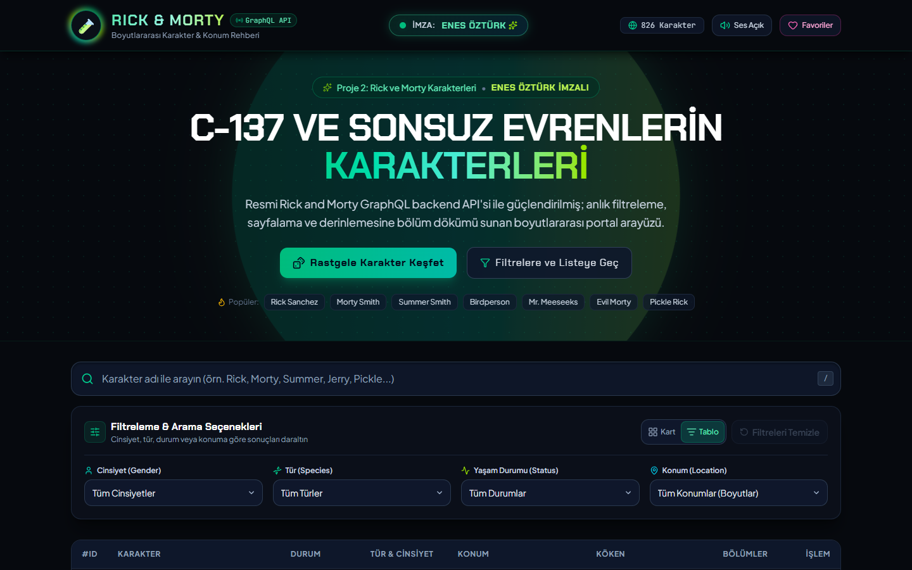
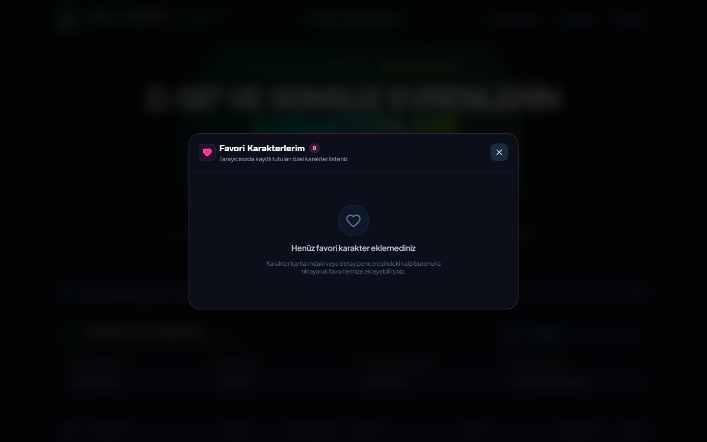

<div align="center">



# Rick & Morty Karakter Portalı

**826 karakter, 51 bölüm ve 126 lokasyon için arama, filtre, kart/tablo görünümü ve favori yönetimi sunan React portalı.**

[](https://github.com/EnesBinMalik/rick-morty-portali)
[](https://github.com/EnesBinMalik/rick-morty-portali)
[](https://github.com/EnesBinMalik/rick-morty-portali)
[](https://github.com/EnesBinMalik/rick-morty-portali)
[](https://github.com/EnesBinMalik/rick-morty-portali)
[](https://github.com/EnesBinMalik)



</div>

---

## Hakkında

Bu portal, Rick and Morty evreninin resmî API'sini kullanarak karakterleri, bölümleri ve konumları tek arayüzde toplar. Canlı arama, durum/tür filtreleri, kart ve tablo görünümleri, favoriler ve rastgele karakter keşfi gibi özelliklerle veri gezinmesi hızlı ve keyiflidir.

> Bu proje **Enes Öztürk** tarafından tasarlanmış, geliştirilmiş ve imzalanmıştır.

---

## Öne çıkan özellikler

| Özellik | Açıklama |
| --- | --- |
| **826 karakter** | Resmî API'den canlı veri çekme ve sayfalama. |
| **Arama & filtre** | İsim, durum ve tür bazlı anlık filtreleme. |
| **Kart / Tablo** | İki farklı görünüm modu arasında geçiş. |
| **Favoriler** | Beğenilen karakterleri yerel olarak saklama. |
| **Rastgele keşif** | Tek tıkla rastgele karakter açma. |
| **Bölüm & lokasyon** | 51 bölüm ve 126 lokasyon referansı. |

---

## Evren

| Ölçü | Değer |
| --- | --- |
| Karakter | 826 |
| Bölüm | 51 |
| Lokasyon | 126 |
| Görünüm | 2 mod |

---

## Galeri







---

## Kurulum

**Gereksinim:** Node.js 20+

```bash
git clone https://github.com/EnesBinMalik/rick-morty-portali.git
cd rick-morty-portali
npm install
npm run dev
```

> Veriler canlı olarak https://rickandmortyapi.com adresinden alınır.

Diğer komutlar:

```bash
npm run build     # Üretim derlemesi
npm run preview   # Derlemeyi önizle
npm run lint      # TypeScript tip kontrolü
```

---

## Teknik mimari

```text
src/services/rickAndMortyApi.ts  API katmanı
src/components/HeroSection.tsx    Karşılama alanı
src/components/FilterBar.tsx      Arama ve filtreler
src/components/CharacterCard.tsx  Kart görünümü
src/components/CharacterTableView.tsx  Tablo görünümü
src/components/FavoritesModal.tsx Favori listesi
```

---

## İmza

<div align="center">

[](https://github.com/EnesBinMalik)
[](https://github.com/EnesBinMalik)

**Bu kod, tasarım ve deneyim Enes Öztürk'ün kişisel imzasını taşır.**

© 2026 Enes Öztürk — Tüm hakları saklıdır.

</div>
